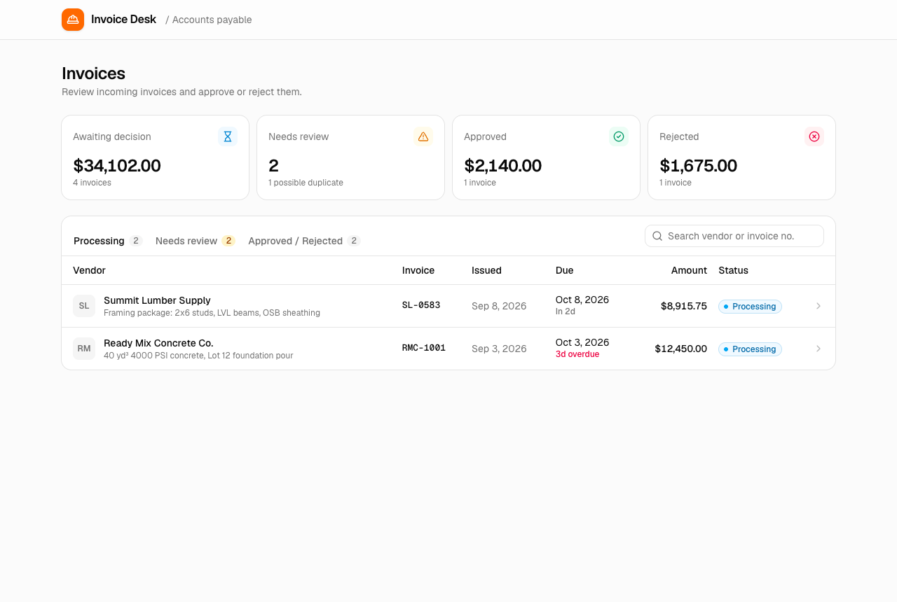
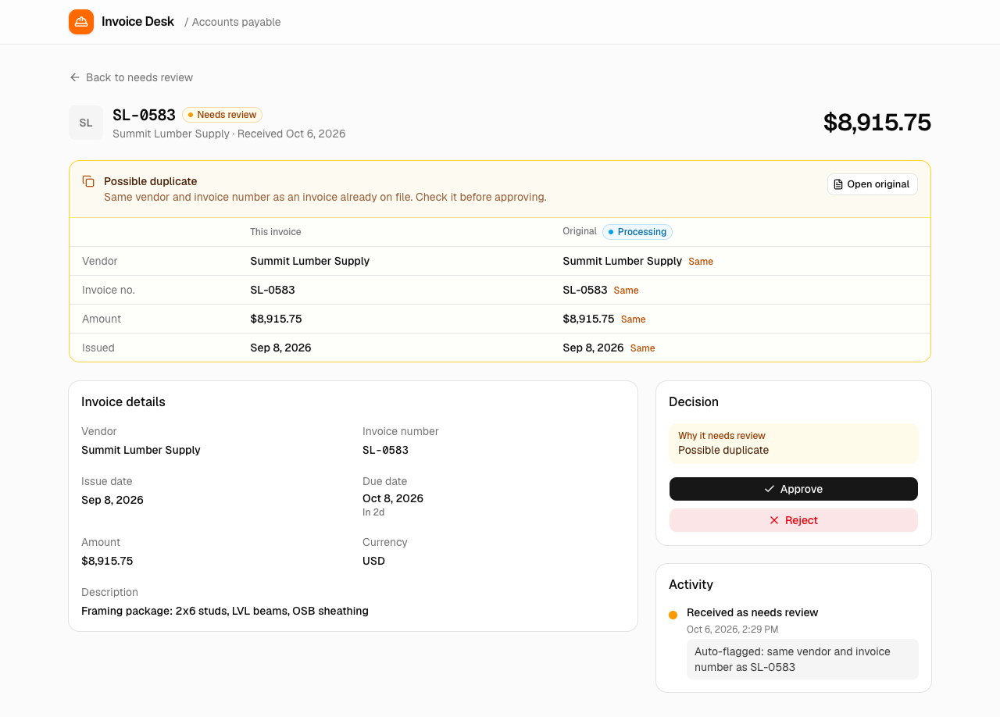
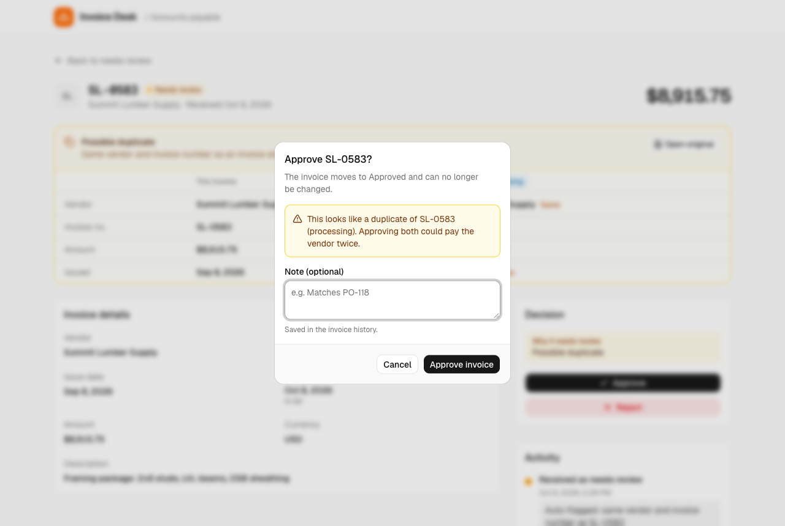
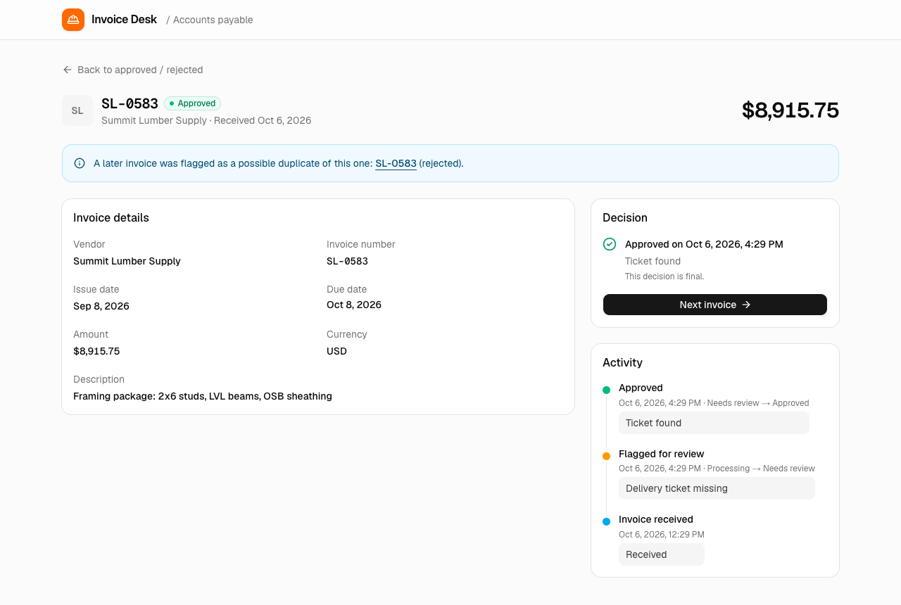

# Invoice Approval Desk

Invoices are grouped into Processing, Needs review and Approved / Rejected tabs. A reviewer can open one, then approve, reject or flag it for review. Every status change is saved in MongoDB with its history.









## Stack

Next.js (App Router), TypeScript, Tailwind CSS, shadcn/ui, MongoDB 7, Zod.

## Running locally

Requires Node.js 22.12+ and Docker.

```bash
git clone [your repo URL]
cd invoice-desk
npm install
cp .env.example .env.local
npm run db:up
npm run db:seed
npm run dev
```

Open http://localhost:3000. `npm run db:seed` resets the sample data.

Run the tests with `npm test`. They use a separate `invoice_desk_test` database, so they need MongoDB running but don't touch the sample data.

To use MongoDB Atlas instead of Docker, put the connection string in `MONGODB_URI` in `.env.local` and skip `npm run db:up`.

## Deploying to Vercel

1. Create a free MongoDB Atlas cluster and allow access from anywhere (`0.0.0.0/0`), since Vercel has no fixed IPs.
2. Import the repo in Vercel and add `MONGODB_URI` (the Atlas connection string) and `MONGODB_DB=invoice_desk` as environment variables.
3. Seed Atlas once from your machine: set the same `MONGODB_URI` in `.env.local` and run `npm run db:seed`.

## API

| Method | Path | Description |
| --- | --- | --- |
| GET | `/api/invoices?status=PROCESSING,NEEDS_REVIEW` | List invoices, optional status filter |
| GET | `/api/invoices/:id` | Invoice with history and duplicate links |
| PATCH | `/api/invoices/:id/status` | Body `{ "status": "APPROVED" \| "REJECTED" \| "NEEDS_REVIEW", "note"?: string }` |

Responses are `{ "data": ... }` or `{ "error": "..." }`, with 400 for invalid input, 404 when not found and 409 when the status change is not allowed.

## Sample data

Six construction invoices covering every status:

| Invoice | Status | Why |
| --- | --- | --- |
| RMC-1001 | Processing | New, overdue |
| SL-0583 | Processing | New |
| BLE-2207 | Needs review | Flagged: hours don't match timesheets |
| SL-0583 | Needs review | Possible duplicate of the SL-0583 above |
| VPD-3340 | Approved | Flagged for a missing PO, then approved |
| DER-7712 | Rejected | Billed for more rental days than used |

The duplicate is at http://localhost:3000/invoices/6701c2a9f1b2c3d4e5f60005

## Schema and statuses

See [WRITEUP.md](WRITEUP.md).
